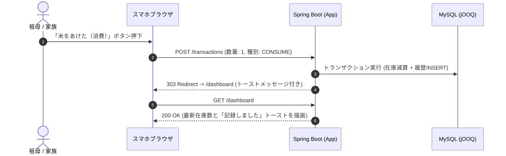

# 全体アーキテクチャ方針書

本ドキュメントは、お米管理Webアプリ（`rice-management`）における全体アーキテクチャおよびシステム構成方針を定義したものです。

---

## 1. 基本方針サマリー

* **構成モデル**: **Spring Boot + Thymeleaf によるサーバーサイドレンダリング（SSR）モノリス構成**
* **実行環境**: **オールDocker構成（全コンポーネントをDockerコンテナ化）**
* **主要スタック**: Java 25 / Spring Boot 4.x / Thymeleaf / jOOQ / MySQL 8.x / Gradle
* **ロードマップ**:
  * **Step 1 (MVP)**: Docker上で動作する完全SSRのWebアプリとして全機能（在庫・出納・マスタ）を実装。
  * **Step 2 (PWA化)**: 安定稼働後、Web App Manifest / Service Workerを導入してスマートフォンのホーム画面からネイティブアプリ感覚で起動できるPWAへ拡張。

---

## 2. システム構成図 (Docker Compose)

アプリケーション（Spring Boot）およびデータベース（MySQL）を含むすべての構成要素をDockerコンテナとして管理し、ローカル開発および本番環境の差異をなくします。

```mermaid
flowchart TD
    subgraph Client ["クライアント（スマートフォン / PC）"]
        Browser["モバイルブラウザ (Mobile Safari / Chrome)\n※Step 2でPWA化（ホーム画面アイコン起動）"]
    end

    subgraph DockerHost ["Docker Compose 環境"]
        direction TB

        subgraph AppContainer ["App コンテナ (rice-app)"]
            SB["Spring Boot 4.x (Java 25)"]
            Thymeleaf["Thymeleaf (SSR)"]
            Tailwind["Tailwind CSS + デジタル庁デザイン"]
            jOOQ["jOOQ (型安全 SQL クエリ)"]
            Flyway["Flyway (DBマイグレーション)"]

            SB --> Thymeleaf
            Thymeleaf --> Tailwind
            SB --> jOOQ
            jOOQ --> Flyway
        end

        subgraph DBContainer ["DB コンテナ (rice-db)"]
            MySQL[("MySQL 8.x")]
            Volume[("Docker Volume\n(永続化ストレージ)")]
            MySQL --- Volume
        end

        AppContainer <-->|JDBC (TCP:3306)| DBContainer
    end

    Browser <-->|HTTP / HTTPS (Port 8080)| AppContainer
```

---

## 3. レンダリング & 画面遷移方式

### 3.1 サーバーサイドレンダリング (SSR)
* **採用技術**: Thymeleaf 3.x
* **採用理由**:
  * 家族内（約6名）の限定利用であり、フロントエンド（React/Vue等）とバックエンドを分離するオーバーヘッド（APIスキーマ二重管理、CORS、ビルド複雑化）を排除。
  * HTMLテンプレートをサーバー側でレンダリングして返却するため、初速（FCP/LCP）が極めて高速で、端末側のJS処理負荷が低い（祖母のスマートフォンでも軽量に動作）。

### 3.2 画面遷移・通信規約: PRG (Post-Redirect-Get) パターン
* 在庫増減や出納記録などのデータ更新操作は、すべて **PRGパターン** で統一します。
* 登録（POST）成功後は必ず詳細・一覧画面へリダイレクト（GET）させ、ブラウザの「戻る」ボタンや「リロード」による**二重登録（多重出庫など）を構造的に防止**します。



---

## 4. PWA化に向けた段階的アプローチ

「まず確実に動くものを作り、その後にPWAを目指す」という方針のもと、以下の2ステップで進めます。

| フェーズ | スコープ | 主な実装内容 |
| :--- | :--- | :--- |
| **Step 1: MVP（初期リリース）** | **SSR Webアプリ** | ・Docker Compose で App + MySQL を一括構築<br>・Spring Boot + Thymeleaf + jOOQ で全コア機能（在庫・入出庫・マスタ）を実装<br>・URLパラメータによる簡易認証と長期セッション保持 |
| **Step 2: PWA化（UX向上）** | **PWA対応** | ・`manifest.json` によるWebアプリマニフェスト定義（アプリアイコン、テーマカラー、スタンドアロン表示）<br>・Service Workerによる静的アセット（CSS/アイコン等）のキャッシュ<br>・スマホの「ホーム画面に追加」プロンプト対応により、アプリ単体のように起動可能にする |

---

## 5. レイヤー構成 & パッケージ標準

Spring Boot アプリケーション内部は、関心事の分離（Separation of Concerns）を明確にする標準的なレイヤードアーキテクチャを採用します。

```text
com.example.ricemanagement/
├── config/             # セキュリティ、WebMvc、jOOQ設定
├── controller/         # Webコントローラ（URLマッピング、リクエスト受付、View返却）
│   ├── dto/            # 画面入出力用フォームオブジェクト（Form / DTO）
├── service/            # ビジネスロジック（在庫計算、トランザクション境界 @Transactional）
├── repository/         # jOOQを用いたデータアクセス層
│   └── generated/      # Flywayマイグレーションから自動生成されたjOOQコード
└── domain/             # ドメインモデル・列挙型（TransactionType, RiceUnit等）
```
