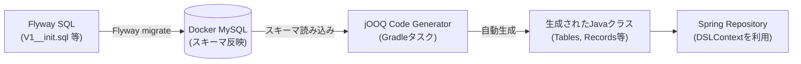
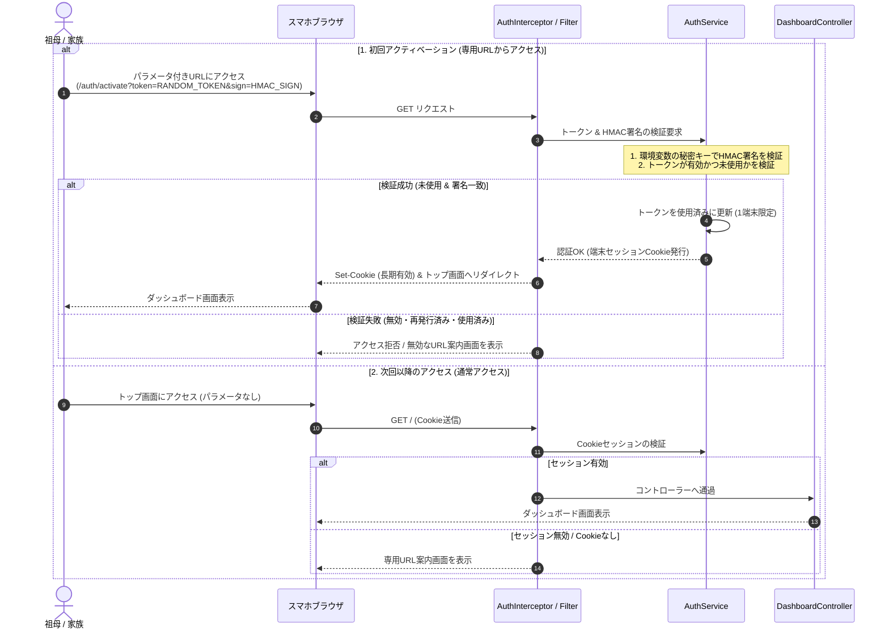

# バックエンド技術選定書

本ドキュメントは、お米管理Webアプリ（`rice-management`）におけるバックエンドの言語・フレームワーク、データアクセス手法（jOOQ）、および認証・ロジック設計を定義したものです。

---

## 1. バックエンド技術スタック一覧

| 項目 | 採用技術 | バージョン / 詳細 | 選定理由 |
| :--- | :--- | :--- | :--- |
| **言語** | **Java** | **Java 25 (LTS)** | 最新の言語機能（パターンマッチング、Record、仮想スレッド等）を活用し、高パフォーマンスかつ堅牢な実装を実現。 |
| **フレームワーク** | **Spring Boot** | **4.x** | Java 25 にネイティブ対応した次世代Spring基盤。堅牢なエコシステムと高い生産性。 |
| **データアクセス (ORM)** | **jOOQ** | **3.x** | MySQLのスキーマからJavaクラスを自動生成し、完全に型安全なSQLクエリを構築。N+1問題や不要な抽象化を排除。 |
| **DBマイグレーション**| **Flyway** | **最新版** | SQLベースでDBスキーマの変更履歴を管理。jOOQコード生成の入力元として機能。 |
| **バリデーション** | **Jakarta Validation** | **3.x (Hibernate Validator)** | フォーム入力値（数量の正数チェック、相手先名必須チェック等）のアノテーション検証。 |
| **ビルドツール** | **Gradle** | **最新版 (Gradle Wrapper)** | ビルド速度、プラグインの柔軟性（jOOQ code generator プラグイン等の導入）。 |

---

## 2. jOOQ によるデータアクセス設計

### 2.1 なぜ jOOQ を選定したか
* **完全な型安全性**: カラム名のタイポやデータ型の不一致は、実行時ではなくコンパイル時にすべて検出。
* **複雑な集計・在庫計算の容易さ**:
  * 「年度ごとの在庫残数」「相手先別の過去の贈答合計」「直近の出納履歴」などの集計クエリを、SQLそのままの感覚で安全に記述可能。
* **JPA/Hibernateとの比較**:
  * エンティティの遅延ロード（Lazy loading）やセッションキャッシュの扱いに悩まされず、直感的で予測可能なSQLが発行される。

### 2.2 jOOQ コード生成のワークフロー



---

## 3. ビジネスロジック & トランザクション設計

### 3.1 在庫増減と履歴記録の原子性保証 (`@Transactional`)
* 出納操作（消費・贈答・補充・修正・削除）は、**「在庫テーブルの更新」と「履歴テーブルへのINSERT/UPDATE」を同一トランザクション** でコミットします。
* 例外が発生した場合は即座に全ロールバックし、不整合（「履歴はあるが在庫が減っていない」等のデータ不整合）を確実に防止します。

```java
@Service
public class TransactionService {

    private final DSLContext dsl;

    @Transactional
    public void recordConsumption(ConsumeForm form, Long memberId) {
        // 1. 履歴レコードの作成
        dsl.insertInto(STOCK_TRANSACTIONS)
           .set(STOCK_TRANSACTIONS.MEMBER_ID, memberId)
           .set(STOCK_TRANSACTIONS.TRANSACTION_TYPE, TransactionType.CONSUME.name())
           .set(STOCK_TRANSACTIONS.BAG_COUNT, form.bagCount())
           .set(STOCK_TRANSACTIONS.RECORDED_AT, form.recordedAt())
           .execute();

        // 2. 在庫残数の減算更新
        dsl.update(RICE_STOCKS)
           .set(RICE_STOCKS.CURRENT_BAGS, RICE_STOCKS.CURRENT_BAGS.minus(form.bagCount()))
           .where(RICE_STOCKS.YEAR.eq(form.riceYear()))
           .execute();
    }
}
```

---

## 4. 認証・アクセス制御設計 (HMAC署名付きURL & 端末Cookie認証)

### 4.1 端末アクティベーション & Cookie認証フロー
シニア層（祖母）にとってパスワード入力は最大の利用障壁となるため、管理画面から発行した専用URL（ランダムトークン ＋ 環境変数秘密キーによるHMAC署名）への初回アクセスにより端末を有効化し、以降は長期セッションCookieで自動ログイン状態を確立します。  
1つのURLは1端末のみアクティベーション可能（ワンタイム招待）とし、URL再発行時は古い未使用URLを即座に無効化します。



### 4.2 実装方針
* **URLパラメータ**:
  - `token`: ランダム生成された一意の文字列。
  - `sign`: サーバー環境変数の秘密キーを鍵として `token` をハッシュ計算したHMAC-SHA256署名。秘密キーをURLに露出させずに改ざんを防止。
* **端末制限（ワンタイム招待）**:
  - 1つのURLから登録できる端末は1台に制限。初回アクセス成功時にトークンを使用済みに更新し、以降の同じURLからの再アクティベーションを拒否。
* **管理画面からの発行・再発行**:
  - 管理画面から端末用URLを生成。再発行時は対象の旧URLトークンを即座に無効化し、古いURLからの新規登録を遮断。
* **セッション管理**:
  - アクティベーション成功時に、暗号論的乱数による端末セッショントークンをCookie（`HttpOnly`, `SameSite=Lax`, `Secure`）として発行。
  - 有効期限は長期（最低30日〜1年等）に設定し、祖母が日常的に再ログインを求められないようにする。
