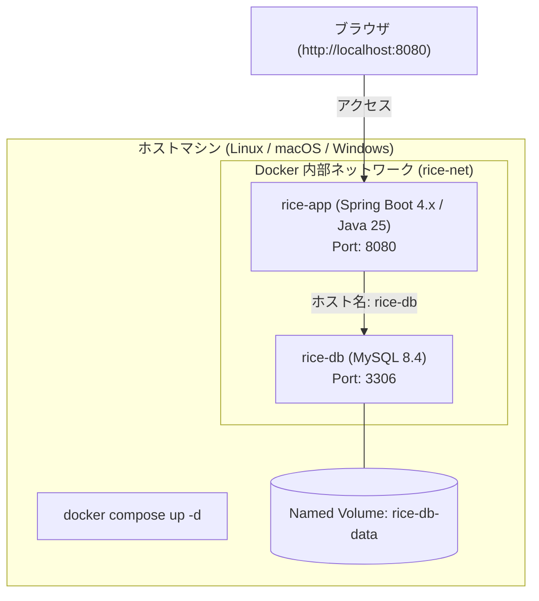
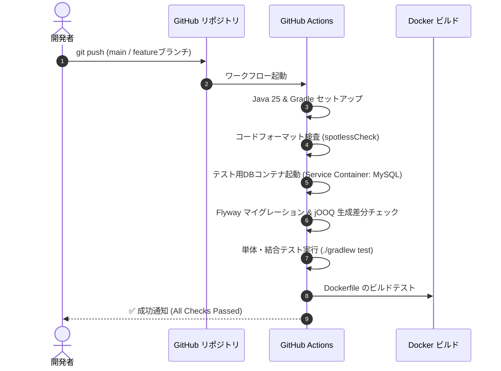

# インフラ・DevOps & 開発運用設計書

本ドキュメントは、お米管理Webアプリ（`rice-management`）におけるビルドツール（Gradle）、オールDocker構成、コンテナデプロイ、およびCI/CDパイプラインを定義したものです。

---

## 1. インフラ・開発運用スタックサマリー

| 項目 | 採用技術 | 選定理由 |
| :--- | :--- | :--- |
| **ビルドツール** | **Gradle (Gradle Wrapper)** | 高速なインクリメンタルビルド、jOOQ code generator プラグインや Docker ビルドとの親和性。 |
| **実行環境** | **オールDocker (Docker Compose)** | アプリ（Spring Boot）もDB（MySQL）もすべてコンテナ化。OSや環境依存トラブルを根絶。 |
| **ベースイメージ** | **Eclipse Temurin / OpenJDK (Java 25 JRE)** | 公式で信頼性の高い軽量ランタイムイメージ。 |
| **CI/CD** | **GitHub Actions** | リポジトリと直結した自動テスト、Gradle ビルド、jOOQコード生成検証、Dockerイメージビルドテスト。 |
| **コードフォーマット** | **Spotless (Gradle Plugin)** | コードスタイルの自動整形（google-java-format 等）をビルドパイプラインに統合。 |

---

## 2. オールDocker構成（Docker Compose）

開発環境・本番環境ともに、`docker compose` のみでシステム全体が起動できるように設計します。

### 2.1 コンテナ構成図


### 2.2 マルチステージビルド Dockerfile (`Dockerfile`)
ビルド用のコンテナ（JDK 25 + Gradle）と実行用のコンテナ（軽量 JRE 25）を分離し、最終コンテナイメージの軽量化とセキュリティ向上を図ります。

```dockerfile
# Stage 1: Build
FROM eclipse-temurin:25-jdk-alpine AS builder
WORKDIR /app
COPY gradlew .
COPY gradle gradle
COPY build.gradle settings.gradle ./
# 依存関係のキャッシュ
RUN ./gradlew dependencies --no-daemon || true
COPY src src
RUN ./gradlew bootJar --no-daemon -x test

# Stage 2: Runtime
FROM eclipse-temurin:25-jre-alpine
WORKDIR /app
# 非rootユーザーでの実行
RUN addgroup -S appgroup && adduser -S appuser -G appgroup
USER appuser
COPY --from=builder /app/build/libs/*.jar app.jar
EXPOSE 8080
ENTRYPOINT ["java", "-jar", "app.jar"]
```

---

## 3. Gradle による開発タスク設計

開発効率を高めるため、主要な作業を Gradle タスクとして一本化します。

| コマンド | 内容 |
| :--- | :--- |
| `./gradlew bootRun` | ローカル開発実行（DBコンテナのみDockerで起動している場合） |
| `./gradlew jooqGenerate` | MySQLのFlywayスキーマから jOOQ のJavaクラスを自動生成 |
| `./gradlew test` | 単体・結合テストの実行 |
| `./gradlew spotlessApply` | ソースコードの自動フォーマット |
| `docker compose up --build` | アプリ・DBをすべてDocker内でビルド・一括起動 |

---

## 4. CI/CD パイプライン (GitHub Actions)

GitHub への Push / Pull Request 時に、自動で品質チェックとビルド検証を実行します。



---

## 5. 本番デプロイ方針

* **コンテナデプロイ**:
  * 作成した Docker イメージをコンテナレジストリ（GHCR: GitHub Packages など）にプッシュし、ホスティング環境（VPS、クラウドサーバー、自宅サーバー等）で `docker compose pull && docker compose up -d` によりゼロダウンタイム/即時反映。
* **環境変数の分離**:
  * DBパスワードや認証用シークレットキーは `.env` ファイルまたは環境変数でコンテナ外部から注入し、Git管理対象外とします。
