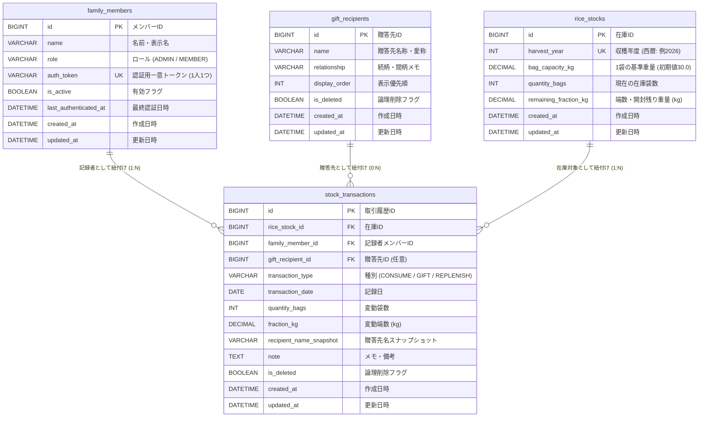

# データモデル・ER図・テーブル定義書

本ドキュメントは、お米管理Webアプリ（`rice-management`）におけるデータベース物理設計、ER図、テーブル定義、インデックス方針、および整合性維持ルールを定めた設計書です。  
ユーザー要件および技術スタック（MySQL 8.x, Flyway, jOOQ）に準拠しています。

---

## 1. データモデル設計方針

1. **家族マスタと認証情報の統合**:
   - アプリの利用者ごとにID/パスワードを発行するのではなく、**家族メンバー1人につき1つの専用認証トークン（URL認証用）を同一テーブル（`family_members`）で一元管理**します。
   - ログイン中の家族メンバー情報が、各入出庫トランザクション（`stock_transactions`）の記録者（`family_member_id`）として自動的に紐付けられます。
2. **年度別在庫管理と入出庫の整合性**:
   - 保冷庫内の米は収穫年度（令和○年度 / 西暦）ごとに区分して管理します。
   - `rice_stocks` で現在の在庫残数を保持しつつ、全ての在庫増減履歴は `stock_transactions` に記録します。在庫更新はDBトランザクション（ACID特性）内で整合性を保証します。
3. **端数（kg）および袋サイズの柔軟な対応**:
   - 原則は「1袋（30kg）」ですが、30kg未満の小分け袋や端数（kg）にも対応できるよう、袋容量および端数量のカラムを用意します。
4. **共通カラムと監査方針**:
   - 全テーブルに `created_at`（登録日時）および `updated_at`（更新日時）を配備。
   - 履歴データやマスタデータの誤削除・巻き戻しに対応できるよう、論理削除フラグ（`is_deleted`）を採用します。

---

## 2. ER図 (Mermaid)



---

## 3. テーブル一覧

| 物理テーブル名 | 論理テーブル名 | 主キー | 概要 |
| :--- | :--- | :--- | :--- |
| **`family_members`** | 家族メンバー兼認証マスタ | `id` | 家族一人ひとりの情報と、固有の認証用トークンを統合保持するテーブル。 |
| **`rice_stocks`** | 米在庫テーブル | `id` | 収穫年度ごとの現在庫袋数、基準容量、および端数（kg）を保持するテーブル。 |
| **`gift_recipients`** | 贈答先マスタ | `id` | よく米を配る親戚・知人の一覧。入力補助と過去履歴の紐付けに利用。 |
| **`stock_transactions`** | 入出庫履歴テーブル | `id` | 自宅消費・贈答・補充の全出納記録。誰がいつ何をどれだけ動かしたかを保持。 |

---

## 4. テーブル詳細定義書

### 4.1 `family_members`（家族メンバー兼認証マスタ）
家族メンバーの基本情報と、専用URL認証・端末認証に利用するトークンを1つのレコードとして保持します。

| カラム物理名 | カラム論理名 | データ型 | NULL | 初期値 | 制約 / インデックス | 備考 |
| :--- | :--- | :--- | :---: | :--- | :---: | :--- |
| **`id`** | メンバーID | `BIGINT` | ✕ | AUTO_INCREMENT | PK | 一意識別子 |
| **`name`** | メンバー表示名 | `VARCHAR(50)` | ✕ | - | - | 例: 「おばあちゃん」「お父さん」「長男」 |
| **`role`** | 権限ロール | `VARCHAR(20)` | ✕ | `'MEMBER'` | - | `'ADMIN'`（管理・URL発行可） / `'MEMBER'`（通常利用） |
| **`auth_token`** | 認証トークン | `VARCHAR(64)` | ✕ | - | **UK** | 1人1つのランダム文字列（HMAC署名URLの元トークン） |
| **`cookie_token`** | セッション | `VARCHAR(100)` | ✕ | - | **UK** | cookieに保存するセッション |
| **`is_active`** | 有効状態 | `TINYINT(1)` | ✕ | `1` | - | `1`: 有効, `0`: 無効（アクセス拒否） |
| **`last_authenticated_at`** | 最終認証日時 | `DATETIME` | ◯ | `NULL` | - | URLアクセスまたはCookieによる最終ログイン日時 |
| **`created_at`** | 作成日時 | `DATETIME` | ✕ | `CURRENT_TIMESTAMP` | - | システム登録日時 |
| **`updated_at`** | 更新日時 | `DATETIME` | ✕ | `CURRENT_TIMESTAMP` | - | レコード更新日時 (ON UPDATE) |

---

### 4.2 `rice_stocks`（米在庫テーブル）
収穫年度ごとに在庫を管理します。通常は1年ごとに1レコード生成されます。

| カラム物理名 | カラム論理名 | データ型 | NULL | 初期値 | 制約 / インデックス | 備考 |
| :--- | :--- | :--- | :---: | :--- | :---: | :--- |
| **`id`** | 在庫ID | `BIGINT` | ✕ | AUTO_INCREMENT | PK | 一意識別子 |
| **`harvest_year`** | 収穫年度 | `INT` | ✕ | - | **UK** | 西暦年（例: `2026` = 令和8年度米） |
| **`bag_capacity_kg`** | 袋基準容量 | `DECIMAL(5,2)` | ✕ | `30.00` | - | 1袋あたりの重量（標準は30.00kg） |
| **`quantity_bags`** | 現在庫袋数 | `INT` | ✕ | `0` | - | 保冷庫内の未開封の袋数 |
| **`remaining_fraction_kg`** | 端数・端数袋重量 | `DECIMAL(5,2)` | ✕ | `0.00` | - | 30kg未満の袋や開封後の端数重量（kg） |
| **`created_at`** | 作成日時 | `DATETIME` | ✕ | `CURRENT_TIMESTAMP` | - | 初期在庫登録日時 |
| **`updated_at`** | 更新日時 | `DATETIME` | ✕ | `CURRENT_TIMESTAMP` | - | 在庫変動・更新日時 (ON UPDATE) |

---

### 4.3 `gift_recipients`（贈答先マスタ）
親戚や知人のマスタです。高齢の祖母がスマホで入力する際、ボタンで選択できるようにするための候補データです。

| カラム物理名 | カラム論理名 | データ型 | NULL | 初期値 | 制約 / インデックス | 備考 |
| :--- | :--- | :--- | :---: | :--- | :---: | :--- |
| **`id`** | 贈答先ID | `BIGINT` | ✕ | AUTO_INCREMENT | PK | 一意識別子 |
| **`name`** | 贈答先名 | `VARCHAR(100)` | ✕ | - | - | 例: 「叔父さん」「長男宅」「佐藤さん」 |
| **`relationship`** | 間柄・メモ | `VARCHAR(255)` | ◯ | `NULL` | - | 例: 「父の弟」「野菜をくれる知人」 |
| **`is_deleted`** | 削除フラグ | `TINYINT(1)` | ✕ | `0` | INDEX | `0`: 有効, `1`: 削除済み（論理削除） |
| **`created_at`** | 作成日時 | `DATETIME` | ✕ | `CURRENT_TIMESTAMP` | - | 登録日時 |
| **`updated_at`** | 更新日時 | `DATETIME` | ✕ | `CURRENT_TIMESTAMP` | - | 更新日時 (ON UPDATE) |

---

### 4.4 `stock_transactions`（入出庫履歴テーブル）
米の「消費」「贈答」「補充」の全イベントを記録します。

| カラム物理名 | カラム論理名 | データ型 | NULL | 初期値 | 制約 / インデックス | 備考 |
| :--- | :--- | :--- | :---: | :--- | :---: | :--- |
| **`id`** | 取引履歴ID | `BIGINT` | ✕ | AUTO_INCREMENT | PK | 一意識別子 |
| **`rice_stock_id`** | 在庫ID | `BIGINT` | ✕ | - | **FK**, INDEX | 対象の年度在庫レコードへの参照 |
| **`family_member_id`** | 記録者メンバーID | `BIGINT` | ✕ | - | **FK**, INDEX | 操作した家族（ログイン中ユーザー） |
| **`gift_recipient_id`** | 贈答先ID | `BIGINT` | ◯ | `NULL` | **FK**, INDEX | 贈答（`GIFT`）時のマスタ参照。任意 |
| **`transaction_type`** | 取引種別 | `VARCHAR(20)` | ✕ | - | INDEX | `'CONSUME'`（消費）/ `'GIFT'`（贈答）/ `'REPLENISH'`（補充） |
| **`transaction_date`** | 取引日 | `DATE` | ✕ | - | INDEX | 米を動かした日付（標準は当日） |
| **`quantity_bags`** | 変動袋数 | `INT` | ✕ | `1` | - | 変動袋数（正の整数。種別によって加減判定） |
| **`fraction_kg`** | 変動端数(kg) | `DECIMAL(5,2)` | ✕ | `0.00` | - | 袋未満の端数重量（kg） |
| **`recipient_name_snapshot`** | 相手先スナップショット | `VARCHAR(100)` | ◯ | `NULL` | - | マスタ削除時や直接入力時の相手名保持用 |
| **`note`** | メモ | `TEXT` | ◯ | `NULL` | - | 「米櫃に入れた」「お礼の手土産」など |
| **`is_deleted`** | 削除フラグ | `TINYINT(1)` | ✕ | `0` | INDEX | `0`: 有効, `1`: 取消・削除済み |
| **`created_at`** | 作成日時 | `DATETIME` | ✕ | `CURRENT_TIMESTAMP` | - | システム登録日時 |
| **`updated_at`** | 更新日時 | `DATETIME` | ✕ | `CURRENT_TIMESTAMP` | - | レコード変更日時 (ON UPDATE) |

---

## 5. インデックス & 外部キー制約設計

### 5.1 外部キー制約 (Foreign Key)
| テーブル名 | 対象カラム | 参照先テーブル・カラム | ON UPDATE | ON DELETE | 理由 |
| :--- | :--- | :--- | :---: | :---: | :--- |
| `stock_transactions` | `rice_stock_id` | `rice_stocks(id)` | RESTRICT | RESTRICT | 在庫データが存在しない履歴の発生を防ぐ |
| `stock_transactions` | `family_member_id` | `family_members(id)` | RESTRICT | RESTRICT | 誰が登録したか分からない履歴の発生を防ぐ |
| `stock_transactions` | `gift_recipient_id` | `gift_recipients(id)` | RESTRICT | SET NULL | 贈答先マスタが整理されても履歴自体は保持 |

### 5.2 複合インデックス (Performance Index)
履歴一覧・検索（`HIS-01`, `HIS-02`）を高速化するため、以下のインデックスを設定します。

1. **履歴一覧の時系列ソート用**:
   - `idx_tx_date_created` : `(is_deleted, transaction_date DESC, created_at DESC)`
   - 目的: 削除されていない履歴を最新順で素早く取得する。
2. **種別・相手先絞り込み用**:
   - `idx_tx_type` : `(transaction_type, is_deleted)`
   - `idx_tx_recipient` : `(gift_recipient_id, is_deleted)`

---

## 6. 在庫更新とトランザクション整合性ルール

1. **登録時の在庫連動**:
   - `stock_transactions` への登録と `rice_stocks` の残数更新は、Spring Boot の `@Transactional` 内で単一トランザクションとして実行します。
   - `CONSUME`（消費）および `GIFT`（贈答）: `rice_stocks.quantity_bags = quantity_bags - ?`
   - `REPLENISH`（補充）: `rice_stocks.quantity_bags = quantity_bags + ?`
2. **編集・削除時の巻き戻し**:
   - 履歴が編集された場合: 旧数量を巻き戻した上で新数量を再適用。
   - 履歴が論理削除された場合: 該当取引の袋数を逆算して `rice_stocks` に即時反映。
3. **在庫マイナス時の取り扱い**:
   - 要件定義書に基づき、残数が0を下回る場合でもDB制約ではエラー（`CHECK (quantity_bags >= 0)`）で弾かず、アプリケーション層で警告を表示した上で登録を許容します（実世界の数え間違い等に対応するため）。

---

## 7. 初期マイグレーションDDL案 (`V1__create_initial_schema.sql`)

```sql
-- 1. 家族メンバー兼認証マスタ
CREATE TABLE family_members (
    id BIGINT AUTO_INCREMENT PRIMARY KEY,
    name VARCHAR(50) NOT NULL COMMENT '表示名（おばあちゃん、お父さん等）',
    role VARCHAR(20) NOT NULL DEFAULT 'MEMBER' COMMENT 'ロール（ADMIN / MEMBER）',
    auth_token VARCHAR(64) NOT NULL UNIQUE COMMENT '1人1つの認証用一意トークン',
    is_active TINYINT(1) NOT NULL DEFAULT 1 COMMENT '有効フラグ（1:有効, 0:無効）',
    last_authenticated_at DATETIME NULL COMMENT '最終認証日時',
    created_at DATETIME NOT NULL DEFAULT CURRENT_TIMESTAMP,
    updated_at DATETIME NOT NULL DEFAULT CURRENT_TIMESTAMP ON UPDATE CURRENT_TIMESTAMP
) ENGINE=InnoDB DEFAULT CHARSET=utf8mb4 COLLATE=utf8mb4_0900_ai_ci COMMENT='家族メンバー兼認証マスタ';

-- 2. 米在庫テーブル
CREATE TABLE rice_stocks (
    id BIGINT AUTO_INCREMENT PRIMARY KEY,
    harvest_year INT NOT NULL UNIQUE COMMENT '収穫年度（西暦: 2026年など）',
    bag_capacity_kg DECIMAL(5, 2) NOT NULL DEFAULT 30.00 COMMENT '1袋あたりの基準重量(kg)',
    quantity_bags INT NOT NULL DEFAULT 0 COMMENT '保冷庫内未開封袋数',
    remaining_fraction_kg DECIMAL(5, 2) NOT NULL DEFAULT 0.00 COMMENT '端数・開封残り重量(kg)',
    created_at DATETIME NOT NULL DEFAULT CURRENT_TIMESTAMP,
    updated_at DATETIME NOT NULL DEFAULT CURRENT_TIMESTAMP ON UPDATE CURRENT_TIMESTAMP
) ENGINE=InnoDB DEFAULT CHARSET=utf8mb4 COLLATE=utf8mb4_0900_ai_ci COMMENT='米在庫テーブル';

-- 3. 贈答先マスタ
CREATE TABLE gift_recipients (
    id BIGINT AUTO_INCREMENT PRIMARY KEY,
    name VARCHAR(100) NOT NULL COMMENT '贈答先名称・呼称',
    relationship VARCHAR(255) NULL COMMENT '間柄・メモ',
    display_order INT NOT NULL DEFAULT 0 COMMENT '表示順序',
    is_deleted TINYINT(1) NOT NULL DEFAULT 0 COMMENT '論理削除フラグ',
    created_at DATETIME NOT NULL DEFAULT CURRENT_TIMESTAMP,
    updated_at DATETIME NOT NULL DEFAULT CURRENT_TIMESTAMP ON UPDATE CURRENT_TIMESTAMP,
    INDEX idx_recipients_order (is_deleted, display_order)
) ENGINE=InnoDB DEFAULT CHARSET=utf8mb4 COLLATE=utf8mb4_0900_ai_ci COMMENT='贈答先マスタ';

-- 4. 入出庫履歴テーブル
CREATE TABLE stock_transactions (
    id BIGINT AUTO_INCREMENT PRIMARY KEY,
    rice_stock_id BIGINT NOT NULL COMMENT '対象在庫ID',
    family_member_id BIGINT NOT NULL COMMENT '記録者メンバーID',
    gift_recipient_id BIGINT NULL COMMENT '贈答先ID',
    transaction_type VARCHAR(20) NOT NULL COMMENT '取引種別（CONSUME/GIFT/REPLENISH）',
    transaction_date DATE NOT NULL COMMENT '取引日',
    quantity_bags INT NOT NULL DEFAULT 1 COMMENT '変動袋数',
    fraction_kg DECIMAL(5, 2) NOT NULL DEFAULT 0.00 COMMENT '変動端数(kg)',
    recipient_name_snapshot VARCHAR(100) NULL COMMENT '相手名スナップショット',
    note TEXT NULL COMMENT 'メモ',
    is_deleted TINYINT(1) NOT NULL DEFAULT 0 COMMENT '論理削除フラグ',
    created_at DATETIME NOT NULL DEFAULT CURRENT_TIMESTAMP,
    updated_at DATETIME NOT NULL DEFAULT CURRENT_TIMESTAMP ON UPDATE CURRENT_TIMESTAMP,
    CONSTRAINT fk_tx_stock FOREIGN KEY (rice_stock_id) REFERENCES rice_stocks(id),
    CONSTRAINT fk_tx_member FOREIGN KEY (family_member_id) REFERENCES family_members(id),
    CONSTRAINT fk_tx_recipient FOREIGN KEY (gift_recipient_id) REFERENCES gift_recipients(id) ON DELETE SET NULL,
    INDEX idx_tx_date_created (is_deleted, transaction_date DESC, created_at DESC),
    INDEX idx_tx_type (transaction_type, is_deleted),
    INDEX idx_tx_recipient (gift_recipient_id, is_deleted)
) ENGINE=InnoDB DEFAULT CHARSET=utf8mb4 COLLATE=utf8mb4_0900_ai_ci COMMENT='入出庫履歴テーブル';
```
